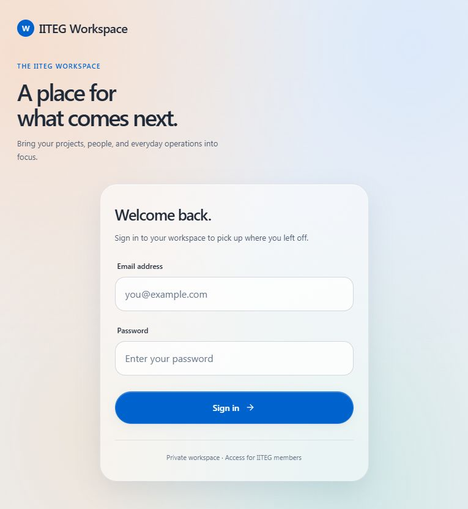
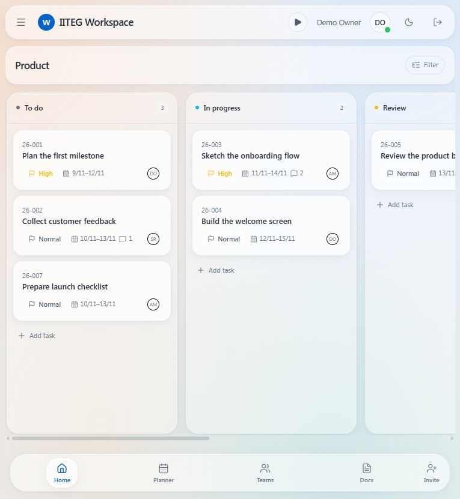
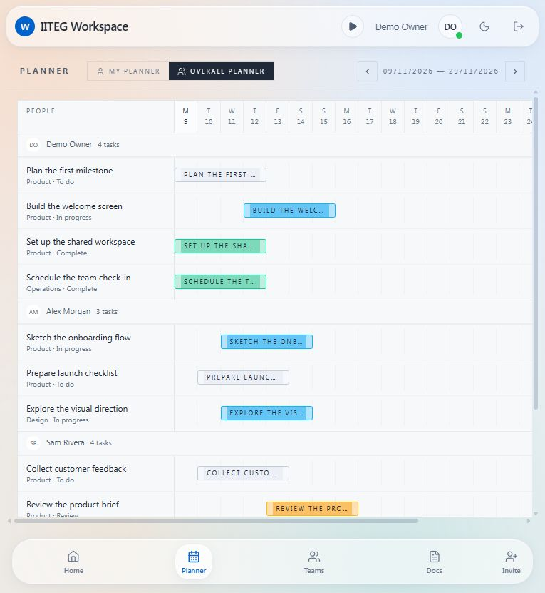
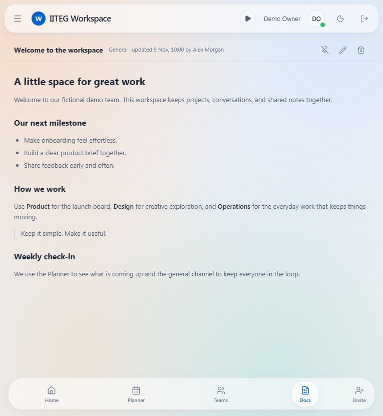

<p></p>

# IITEG Workspace

A self-hosted workspace for projects, people, and everyday collaboration.
Glass-style light and dark themes, without a required hosted service.

**Current release: 0.1.2.** This is a standalone distribution, with a fresh
database and no company data, private integrations, or business-specific modules.

## Included

- Nested spaces, Kanban boards, custom columns, subtasks, multiple assignees,
  priorities, dates, project numbering, comments, and time tracking.
- Channels, direct messages, replies, reactions, mentions, unread state, presence,
  image/file attachments, and profiles.
- Shared Markdown documents, a drag-to-schedule planner, teams, custom roles,
  and private spaces/channels.
- A small, trusted extension registry for custom subsidiaries and React panels.
- Optional fictional demo content: Product, Design and Operations spaces, tasks,
  documents, channels, and demo members. No demo passwords are shipped.

## Screenshots

Actual application screens using fictional, read-only demo content.

| Sign in | Kanban |
| --- | --- |
|  |  |
| **Planner** | **Documents** |
|  |  |

[View the Kanban filter overlay](screenshots/kanban-filter-demo.jpg).

## Try the dummy-data preview

The release ZIP includes the prebuilt app. With Node.js 22.12+ installed, extract
it and run this from the extracted project folder:

```sh
node tools/demo-server.mjs
```

Open **http://127.0.0.1:8180**. Use `demo@example.com` and `demo` in the sign-in
form. These are fictional preview values, not real account credentials.
The preview is read-only, binds to loopback, and never connects to a database,
production API, or company installation. For a source checkout, run `npm ci`
and `npm run build` first; `npm run demo` starts the same preview server.
Use Docker below for an editable, persistent installation.

## Quick start with Docker

Requires Docker Engine/Desktop with Compose and Node.js 22.12+ for the initial
configuration command. Do not expose the database or PHP container directly.

```sh
git clone https://github.com/Artis-98/iiteg-workspace.git
cd iiteg-workspace
npm run setup
```

Edit the generated, ignored `.env`: set `ADMIN_EMAIL`, `ADMIN_NAME`, and your own
`ADMIN_PASSWORD` (at least 12 characters). The setup command generates independent
random database passwords and an application signing key; it never overwrites
an existing `.env`. Keep those values private.

```sh
docker compose up --build -d
```

Open **http://localhost:8080** and sign in with your configured owner account.
The setup container initializes the database automatically. Re-running setup
preserves existing records. Fresh installs contain no work data.

### Load the fictional sample workspace

Do this once, before adding your own spaces:

```sh
docker compose run --rm setup php bin/setup.php --demo
```

This creates only fictional people and content. Sample member passwords are
randomly generated and discarded; use your configured owner account to sign in.
Demo seeding refuses a workspace that already has spaces.

## Custom subsidiaries

Edit `src/extensions/manifest.json` to add, rename, or remove subsidiary entries,
then rebuild. A fictional **Example Studio** entry demonstrates the format.
Use `[]` for no subsidiaries. Add trusted custom React panels in
`src/extensions/index.ts`. See [the extension guide](docs/EXTENSIONS.md).
No remote scripts are downloaded or executed as plugins.

## Development and manual hosting

The frontend is React + TanStack Router + Vite + Tailwind. The API is PHP 8.4+
with PDO MySQL, mbstring, and fileinfo, backed by MariaDB 11.4+ or MySQL 8.
See [installation](docs/INSTALL.md), [architecture](docs/ARCHITECTURE.md),
[security and operational limits](SECURITY.md), and [contributing](CONTRIBUTING.md).

```sh
npm ci
npm run dev
npm run build
npm run typecheck
npm test
```

`npm run dev` serves the frontend at port 8080 and proxies `/api` to a local PHP
server on port 8081. `npm run build` produces `dist/client/`. The GitHub release
ZIP includes this prebuilt frontend alongside all source and the PHP API.

## License

MIT. You may self-host, modify, redistribute, and use it commercially under the
license terms. See [LICENSE](LICENSE) and [third-party notices](THIRD_PARTY_NOTICES.md).
